# Robust indoor navigation under changing light: ROS 2 visual SLAM with adaptive multi-sensor fusion

[](https://doi.org/10.1016/j.measurement.2026.120695)


A real robot that keeps mapping and navigating when the lights go down. A monocular camera, a 2D LiDAR, an IMU and wheel encoders are fused in ROS 2. A visual confidence score shifts trust from the camera to the LiDAR as image quality drops, so the robot degrades gracefully instead of failing.

Companion repository to the first-author paper in *Measurement* (Elsevier, 2026). [Read the paper](https://doi.org/10.1016/j.measurement.2026.120695)

<p align="center">
  <a href="media/autonomous_navigation.mp4">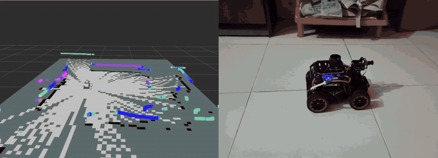</a>
  <br><em>Live occupancy map in RViz (left) and the robot on the floor (right). Click for the full 78 s video.</em>
</p>

<!-- To get an inline video player: edit this README on github.com, drag media/autonomous_navigation.mp4 into the editor, and replace the block above with the link GitHub generates. -->

## Headline results

Ten autonomous trials per lighting condition, on the real robot.

| Lighting | Illuminance | Navigation success | Mean APE (cm) | Initial localisation error (m) |
|---|---|---|---|---|
| Natural daylight | ~25,000 to 30,000 lux | 100% (10/10) | 2.8 ± 1.1 | 0.024 |
| Artificial indoor | ~300 to 500 lux | 100% (10/10) | 2.9 ± 1.0 | 0.037 |
| Low ambient light | ~50 to 100 lux | 90% (9/10) | 4.5 ± 2.3 | 0.062 |
| Complete darkness | 0 lux | 80% (8/10) | 6.2 ± 3.5 | 0.089 |

From best to worst case, occupancy-cell accuracy fell only from 97.5% to 88.2%, and mapping time rose from 68 s to 119 s. No condition caused total failure.

### Why fusion matters: ablation on the same hardware

| Lighting | Monocular ORB-SLAM3 | Visual-inertial (camera + IMU) | **This framework** |
|---|---|---|---|
| Natural daylight | 60% | 80% | **100%** |
| Artificial indoor | 70% | 80% | **100%** |
| Low ambient light | 0% | 30% | **90%** |
| Complete darkness | 0% | 0% | **80%** |

Navigation success over 10 trials each. Vision-only methods collapse in the dark; the fused system keeps going on LiDAR, IMU and encoders.

## The robot

<p align="center">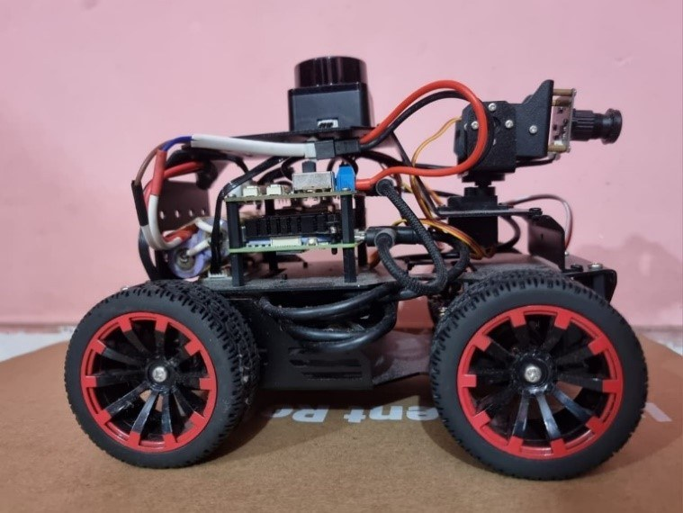</p>

| Component | Role |
|---|---|
| Raspberry Pi 5 | Runs the full ROS 2 stack: ORB-SLAM3, LiDAR SLAM, fusion, Nav2 planners |
| RRC Lite controller | Low-level hub: motor PWM, encoder reading, odometry, power distribution |
| Monocular camera | ORB features, visual odometry, loop closure |
| 360° 2D LiDAR | Lighting-invariant scan matching, occupancy grid, obstacles, metric scale for vision |
| IMU + wheel encoders | Motion propagation and drift constraints between exteroceptive updates |
| 4WD chassis, 8.4 V battery | Mobile base and untethered power |

<p align="center">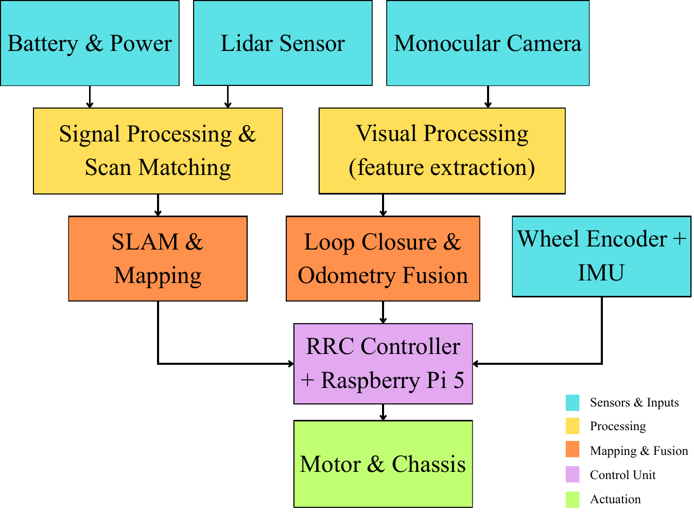</p>

## How it works

<p align="center">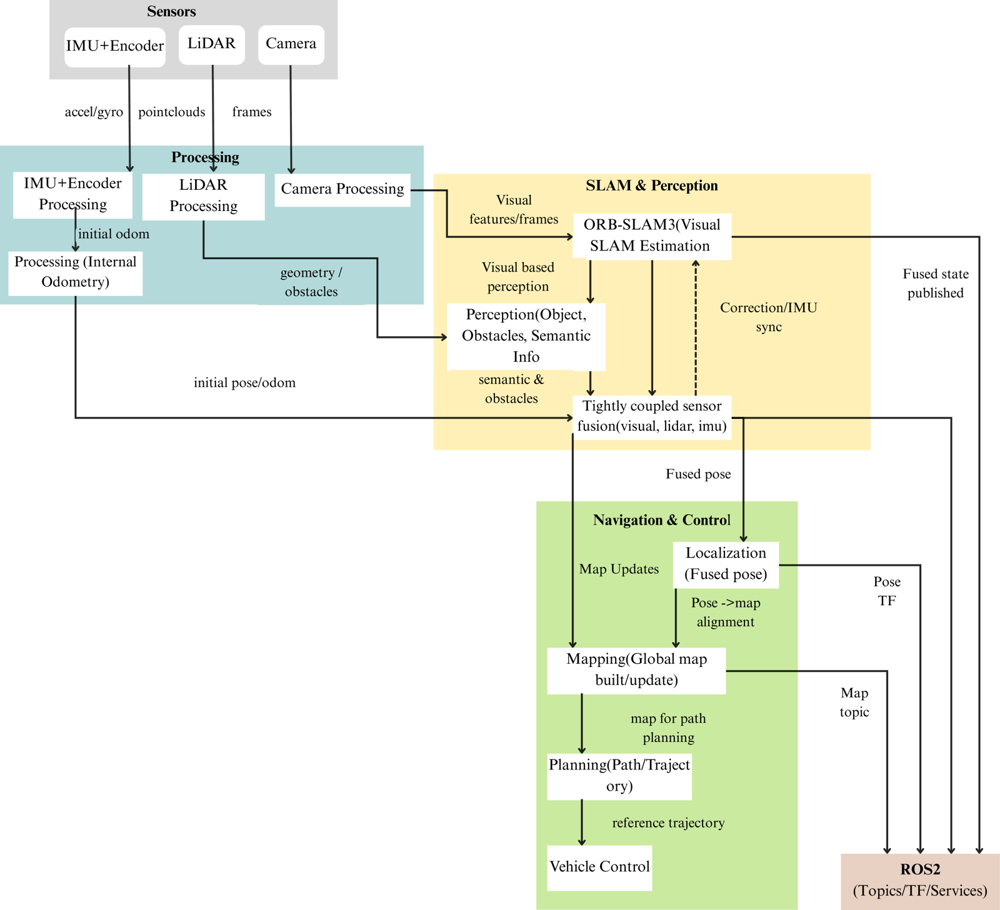</p>

1. **Per-sensor estimates.** ORB-SLAM3 gives a visual pose; LiDAR scan matching gives a geometric pose; the IMU and encoders propagate motion. LiDAR depth also fixes the scale ambiguity of the monocular camera.
2. **Visual confidence score.** Each frame, the system measures how trustworthy the camera is from three signals: the number of tracked ORB features $N_k$, the mean reprojection error $e_k$, and the mean image luminance $L_k$.

$$C_v(k) = \alpha \frac{N_k}{N_{\max}} + \beta \, e^{-e_k} + \gamma \frac{L_k}{L_{\max}}, \qquad \alpha + \beta + \gamma = 1$$

3. **Adaptive weights.** The camera weight is $w_v = \mathrm{clip}(C_v, 0, 1)$ and the LiDAR weight is its complement $w_l = 1 - w_v$. IMU and encoders keep baseline weights. The fused state is the weighted combination of the four estimates.
4. **Mapping and navigation.** LiDAR builds a 2D occupancy grid (0.05 m per cell). Nav2 plans with NavFn (global) and the Dynamic Window Approach (local).

<p align="center">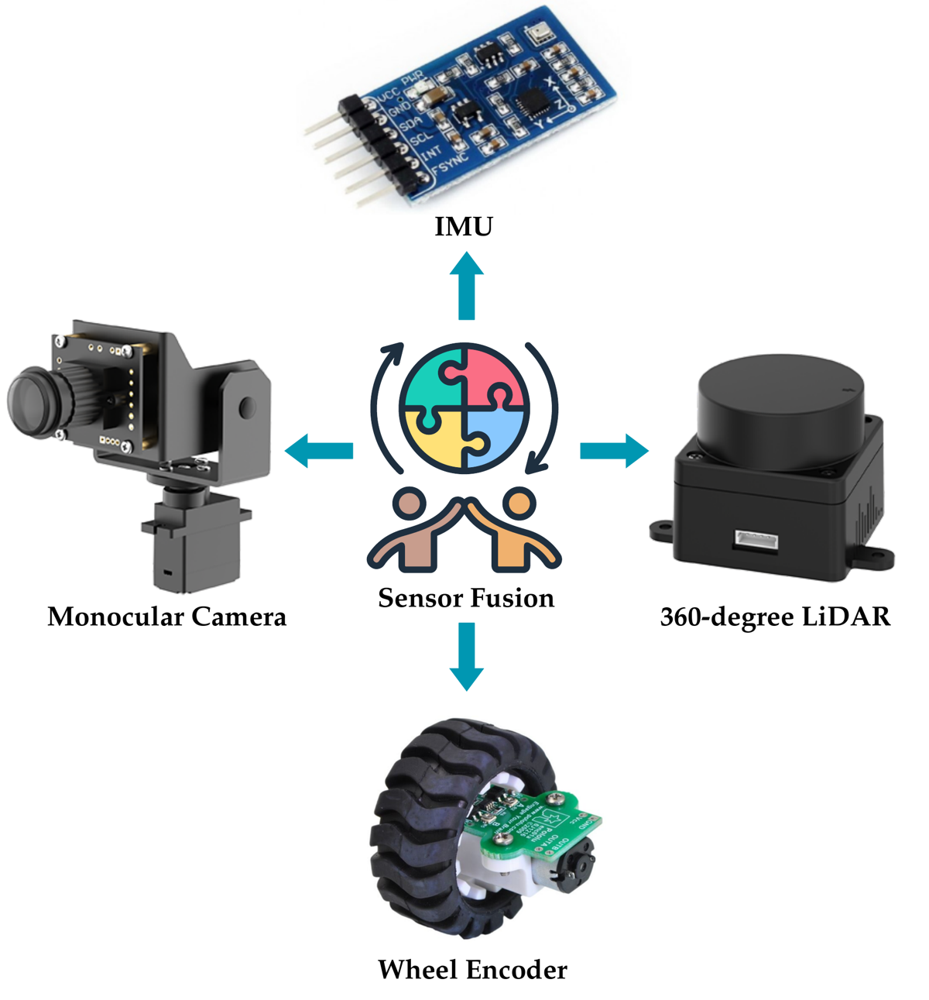</p>

### The weights move with the light

<p align="center">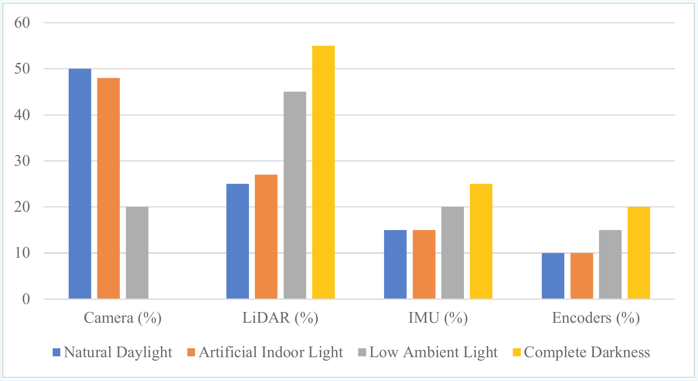</p>

The camera's share falls from 50% in daylight to 0% in darkness, while LiDAR rises from 25% to 55%. These shares come out of the confidence score, not hand tuning.

## Results in pictures

**Real world: one map per lighting condition**

| Daylight | Artificial light |
|---|---|
| 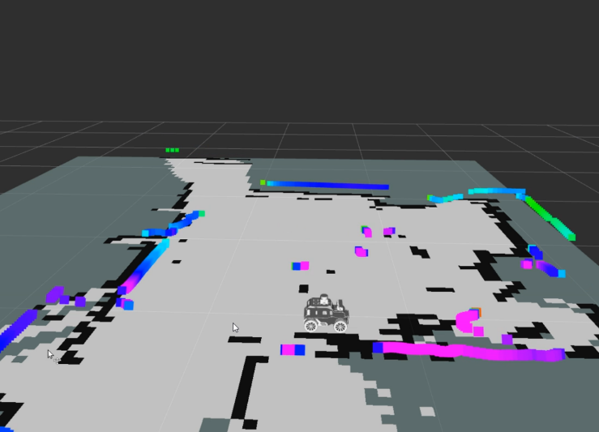 | 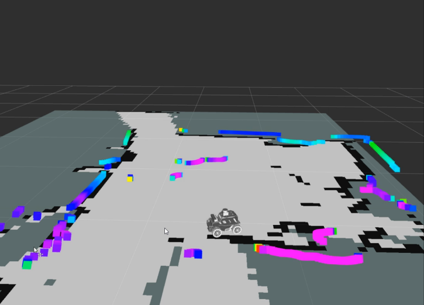 |
| **Low ambient light** | **Complete darkness** |
| 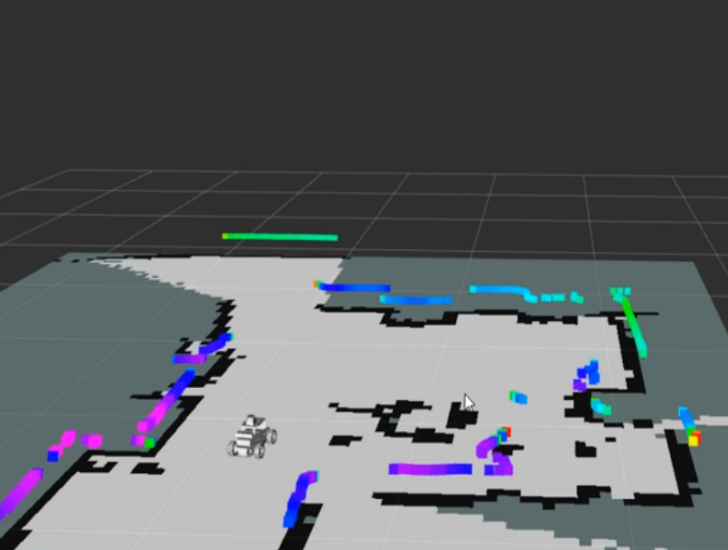 | 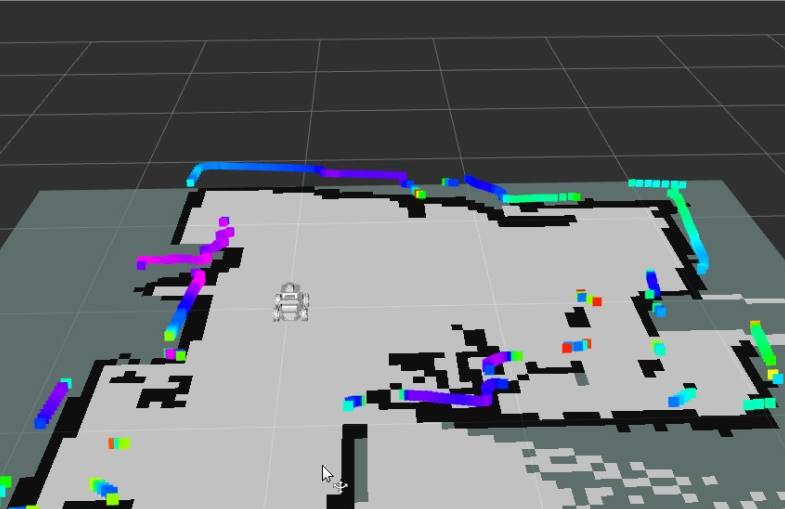 |

In low light and darkness the map keeps its geometry but loses visual detail, because LiDAR takes over.

**Mapping quality under each condition**

| Mapping time | Initial localisation error |
|---|---|
| 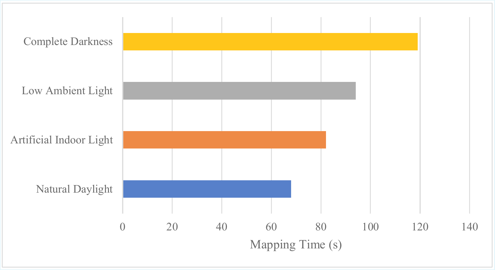 | 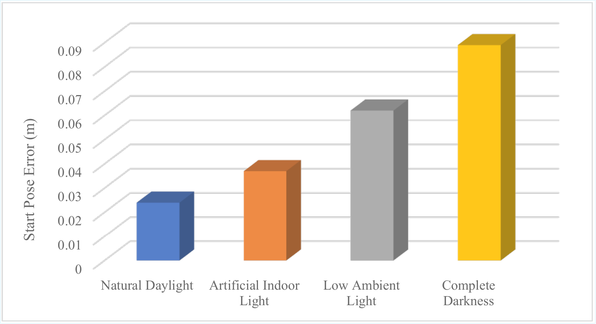 |
| **Map size (cells)** | **Occupancy cell accuracy** |
| 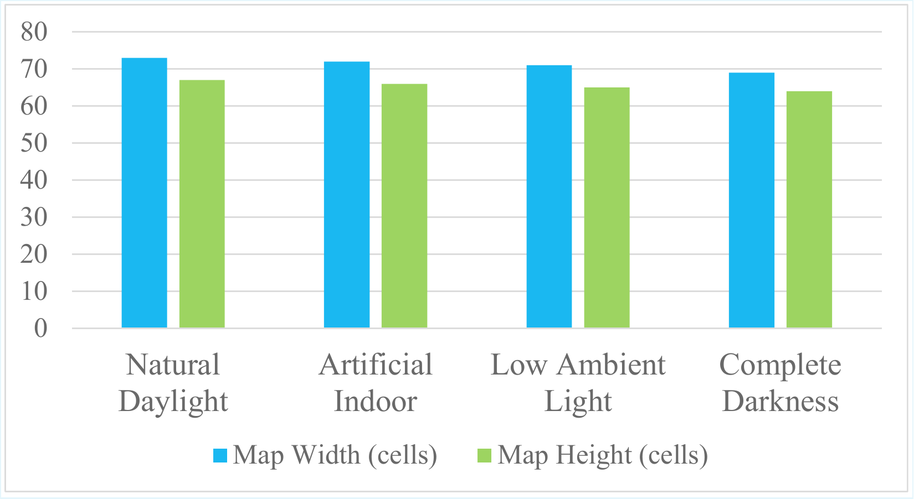 | 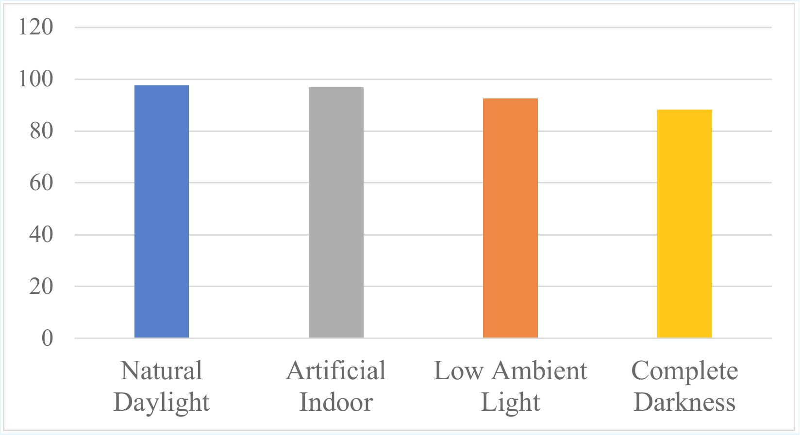 |

**Simulation: Gazebo, AWS RoboMaker Small Warehouse, MiR 250 model**

| Start | Goal set | Arrived |
|---|---|---|
| 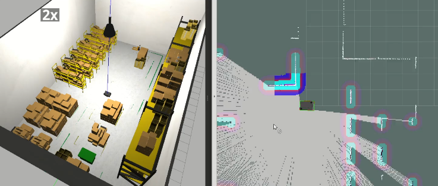 | 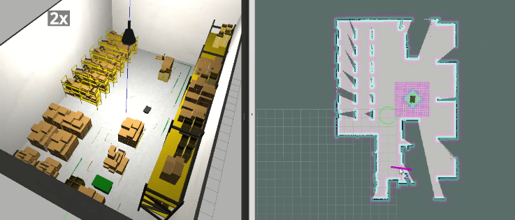 | 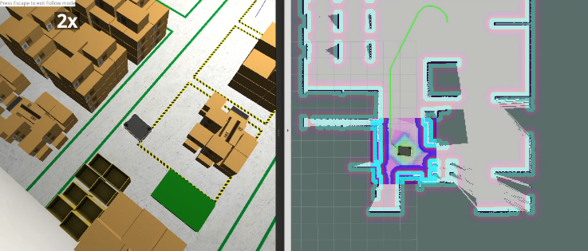 |

## Runs on a Raspberry Pi 5

Estimated per-frame cost during steady operation:

| Module | ms per frame |
|---|---|
| Visual feature extraction and tracking | 38 to 42 |
| LiDAR-based depth correction | 32 to 36 |
| Factor graph optimisation (back end) | 48 to 55 |
| IMU pre-integration | 6 to 7 |
| Wheel encoder fusion | 4 to 5 |
| **Total** | **130 to 145 (about 7 to 8 FPS)** |

That rate is enough for indoor speeds below 0.5 m/s.

## Test protocol

- Real-world arena: 12 × 11 ft indoor space; 10 trials per lighting condition between fixed start and goal poses.
- Metrics: Absolute Pose Error (APE) against ground truth, and navigation success rate.
- Simulation first in Gazebo, then deployment on the physical robot.

## Tech stack

ROS 2 · ORB-SLAM3 · slam_toolbox · robot_localization · Nav2 (NavFn, DWA) · Gazebo · RViz · Raspberry Pi 5

## Citation

Rahman, M.M., Mahmud, J.A., Ali, M.F., Rahim, M.A., Sarker, S.K. and Yan, B. (2026). ROS2-based real-time autonomous mapping and navigation: Integrating visual SLAM and sensor fusion with performance analysis under varying light. *Measurement*, 268, 120695. https://doi.org/10.1016/j.measurement.2026.120695

```bibtex
@article{rahman2026ros2,
  author  = {Rahman, Md. Musfiqur and Mahmud, J. A. and Ali, Md. Firoj and Rahim, M. A. and Sarker, S. K. and Yan, B.},
  title   = {{ROS2}-based real-time autonomous mapping and navigation: Integrating visual {SLAM} and sensor fusion with performance analysis under varying light},
  journal = {Measurement},
  volume  = {268},
  pages   = {120695},
  year    = {2026},
  doi     = {10.1016/j.measurement.2026.120695}
}
```

## Rights

Figures, tables and results above are reproduced from the article with full acknowledgement: Rahman et al., *Measurement* 268 (2026) 120695, https://doi.org/10.1016/j.measurement.2026.120695, © 2026 Elsevier Ltd, reused under the authors' retained rights. The published article itself is not redistributed here.

The robot photo and the navigation video are the author's own.

## Author

**Md. Musfiqur Rahman**, BSc Mechatronics Engineering, Rajshahi University of Engineering & Technology (RUET). musfiqurtonmoy@gmail.com · [GitHub](https://github.com/musfiqurtonmoy)
